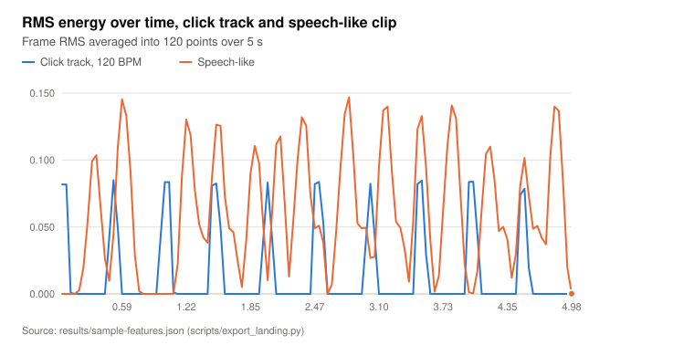
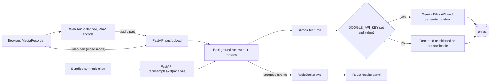
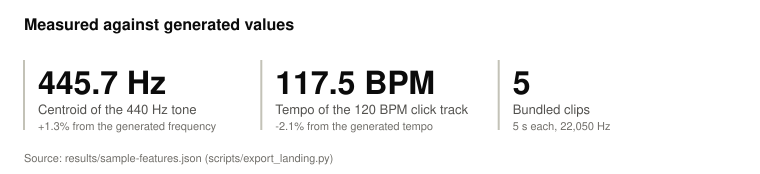
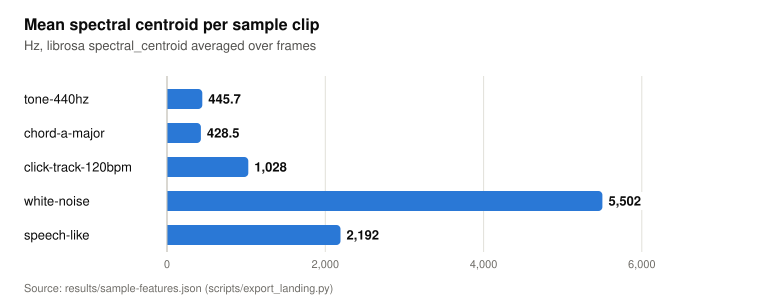
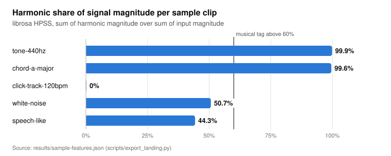

# audio-video-analyzer

Records audio or video in the browser, extracts clip-level and frame-level audio features with librosa, and, when a Gemini API key is set, asks a Gemini model to describe the video with those features as context. A FastAPI backend stores each run in SQLite and streams progress to a React client over WebSocket.

<picture>
  <source media="(prefers-color-scheme: dark)" srcset="docs/figures/rms-over-time-dark.svg">
  
</picture>

<details><summary>Data table</summary>

|  | Click track, 120 BPM | Speech-like |
|---|---|---|
| 0.00 | 0.082 | 0.000 |
| 0.03 | 0.082 | 0.000 |
| 0.08 | 0.001 | 0.000 |
| 0.13 | 0.000 | 0.000 |
| 0.17 | 0.000 | 0.003 |
| 0.21 | 0.000 | 0.020 |
| 0.24 | 0.000 | 0.055 |
| 0.29 | 0.000 | 0.099 |
| 0.34 | 0.000 | 0.104 |
| 0.38 | 0.000 | 0.064 |
| 0.42 | 0.000 | 0.026 |
| 0.45 | 0.042 | 0.010 |
| 0.50 | 0.085 | 0.045 |
| 0.55 | 0.050 | 0.109 |
| 0.59 | 0.000 | 0.145 |
| 0.63 | 0.000 | 0.133 |
| 0.66 | 0.000 | 0.091 |
| 0.71 | 0.000 | 0.029 |
| 0.75 | 0.000 | 0.002 |
| 0.80 | 0.000 | 0.000 |
| 0.84 | 0.000 | 0.000 |
| 0.87 | 0.000 | 0.000 |
| 0.92 | 0.000 | 0.000 |
| 0.96 | 0.042 | 0.000 |
| 1.01 | 0.084 | 0.000 |
| 1.04 | 0.084 | 0.000 |
| 1.08 | 0.001 | 0.000 |
| 1.13 | 0.000 | 0.022 |
| 1.17 | 0.000 | 0.089 |
| 1.22 | 0.000 | 0.130 |
| 1.25 | 0.000 | 0.119 |
| 1.29 | 0.000 | 0.077 |
| 1.34 | 0.000 | 0.052 |
| 1.38 | 0.000 | 0.042 |
| 1.43 | 0.000 | 0.038 |
| 1.46 | 0.081 | 0.087 |
| 1.50 | 0.082 | 0.126 |
| 1.54 | 0.050 | 0.126 |
| 1.59 | 0.000 | 0.073 |
| 1.64 | 0.000 | 0.049 |
| 1.67 | 0.000 | 0.046 |
| 1.71 | 0.000 | 0.024 |
| 1.75 | 0.000 | 0.005 |
| 1.80 | 0.000 | 0.039 |
| 1.85 | 0.000 | 0.090 |
| 1.88 | 0.000 | 0.111 |
| 1.92 | 0.000 | 0.098 |
| 1.96 | 0.042 | 0.050 |
| 2.01 | 0.083 | 0.010 |
| 2.05 | 0.043 | 0.059 |
| 2.09 | 0.000 | 0.112 |
| 2.12 | 0.000 | 0.118 |
| 2.17 | 0.000 | 0.067 |
| 2.22 | 0.000 | 0.013 |
| 2.26 | 0.000 | 0.055 |
| 2.30 | 0.000 | 0.101 |
| 2.33 | 0.000 | 0.132 |
| 2.38 | 0.000 | 0.126 |
| 2.43 | 0.000 | 0.073 |
| 2.47 | 0.082 | 0.049 |
| 2.51 | 0.084 | 0.051 |
| 2.54 | 0.053 | 0.039 |
| 2.59 | 0.000 | 0.000 |
| 2.64 | 0.000 | 0.007 |
| 2.68 | 0.000 | 0.046 |
| 2.72 | 0.000 | 0.094 |
| 2.75 | 0.000 | 0.135 |
| 2.80 | 0.000 | 0.147 |
| 2.84 | 0.000 | 0.104 |
| 2.89 | 0.000 | 0.053 |
| 2.93 | 0.000 | 0.049 |
| 2.96 | 0.041 | 0.049 |
| 3.01 | 0.082 | 0.027 |
| 3.05 | 0.043 | 0.028 |
| 3.10 | 0.000 | 0.095 |
| 3.13 | 0.000 | 0.137 |
| 3.17 | 0.000 | 0.140 |
| 3.22 | 0.000 | 0.092 |
| 3.26 | 0.000 | 0.054 |
| 3.31 | 0.000 | 0.049 |
| 3.34 | 0.000 | 0.034 |
| 3.38 | 0.000 | 0.009 |
| 3.42 | 0.000 | 0.054 |
| 3.47 | 0.082 | 0.123 |
| 3.52 | 0.085 | 0.133 |
| 3.55 | 0.029 | 0.094 |
| 3.59 | 0.000 | 0.040 |
| 3.63 | 0.000 | 0.002 |
| 3.68 | 0.000 | 0.013 |
| 3.73 | 0.000 | 0.063 |
| 3.76 | 0.000 | 0.111 |
| 3.80 | 0.000 | 0.141 |
| 3.84 | 0.000 | 0.131 |
| 3.89 | 0.000 | 0.076 |
| 3.94 | 0.000 | 0.023 |
| 3.97 | 0.084 | 0.001 |
| 4.01 | 0.084 | 0.000 |
| 4.05 | 0.044 | 0.017 |
| 4.10 | 0.000 | 0.063 |
| 4.14 | 0.000 | 0.105 |
| 4.18 | 0.000 | 0.110 |
| 4.21 | 0.000 | 0.085 |
| 4.26 | 0.000 | 0.047 |
| 4.31 | 0.000 | 0.050 |
| 4.35 | 0.000 | 0.041 |
| 4.39 | 0.000 | 0.012 |
| 4.42 | 0.000 | 0.030 |
| 4.47 | 0.074 | 0.081 |
| 4.52 | 0.079 | 0.102 |
| 4.56 | 0.019 | 0.073 |
| 4.60 | 0.000 | 0.049 |
| 4.63 | 0.000 | 0.051 |
| 4.68 | 0.000 | 0.042 |
| 4.73 | 0.000 | 0.037 |
| 4.77 | 0.000 | 0.103 |
| 4.81 | 0.000 | 0.140 |
| 4.84 | 0.000 | 0.137 |
| 4.89 | 0.000 | 0.083 |
| 4.93 | 0.000 | 0.020 |
| 4.98 | 0.000 | 0.000 |

Source: `results/sample-features.json (scripts/export_landing.py)`

</details>

Source: chart `rms-over-time` in [docs/data.json](docs/data.json), written by [scripts/export_landing.py](scripts/export_landing.py) from the bundled clips. The interactive charts are on the landing page, [docs/index.html](docs/index.html), which GitHub Pages serves from `/docs` once it is enabled.

## Privacy

- The app records the user's microphone, and in video mode the front camera, through the browser's `getUserMedia` API.
- With `GOOGLE_API_KEY` set, each video recording is uploaded to the Google Gemini Files API for description, and the adapter deletes the remote file when the request ends ([gemini.py](src/av_analyzer/gemini.py)). Google's terms for the Gemini API apply to that upload. Without a key, nothing leaves the machine.
- Uploaded files are written to `data/uploads/` and deleted when the run ends, unless `AVA_KEEP_UPLOADS=1`. Feature results are stored in `data/analyzer.db`. Both paths are gitignored.
- The server binds to 127.0.0.1 by default and has no authentication. POST requests and WebSocket handshakes that carry an `Origin` header outside `AVA_CORS_ORIGINS` are refused with 403, so a web page on another origin cannot start runs or read progress.

## What it does

- Captures audio, or video with audio, with `MediaRecorder`; decodes the recording with the Web Audio API and encodes 16-bit mono WAV in the browser ([wav.js](frontend/src/wav.js)), so the server needs no ffmpeg.
- Computes spectral centroid, rolloff and bandwidth, zero-crossing rate, tempo and beat count, RMS energy, 13 MFCCs (means of the first 5 are stored), chroma and the harmonic and percussive share from librosa HPSS ([features.py](src/av_analyzer/features.py)). RMS and centroid are also returned as 120-point series for the UI sparklines.
- Tags each clip with three fixed-threshold heuristics (harmonic share, RMS level, tempo). These are not a trained classifier.
- For video runs with a key set, uploads the original recording to the Gemini Files API, waits for processing, and asks the model configured in `GEMINI_MODEL` for a description that takes the audio tags as context. Each HTTP request to Gemini times out after `GEMINI_TIMEOUT_S` (default 120) with at most 3 attempts, and the whole step is recorded as `failed` when it exceeds `GEMINI_TIMEOUT_S`.
- Ships five synthetic sample clips generated with a fixed seed, so the full flow runs with no microphone, camera or API key.
- Runs 49 offline tests: feature values on the sample clips, every API route through FastAPI `TestClient` with a stub in place of Gemini, the Gemini adapter against a fake client, and storage.

## How it works



**Upload.** `POST /api/upload` takes an `audio` part (`.wav`, `.flac`, `.ogg` or `.mp3`), an optional `video` part (`.webm`, `.mp4`, `.mov` or `.mkv`) and a `media_type` form field. Files are streamed to disk with a total size limit of `AVA_MAX_UPLOAD_MB` (default 50) and the response returns `202` with the analysis ID ([server.py](src/av_analyzer/server.py)).

**Analysis.** The run executes as a FastAPI background task. librosa and the Gemini client are synchronous, so both run through `asyncio.to_thread` and the event loop keeps delivering WebSocket messages. A clip that cannot be decoded marks the run `failed`. A Gemini error keeps the audio features and records the Gemini step as `failed` with the exception class only.

**Gemini step.** The step has four recorded outcomes: `completed` (description and model ID stored), `skipped` (no `GOOGLE_API_KEY`), `not_applicable` (audio-only run) and `failed`. The UI shows the last three as notices in the result.

## Results

The measurements below come from [results/sample-features.json](results/sample-features.json), written by `uv run python scripts/export_landing.py` from the five clips in [src/av_analyzer/samples/](src/av_analyzer/samples/). The clips are generated by [scripts/make_samples.py](scripts/make_samples.py) with seed 20261030; their manifest records the generated tone frequency and click tempo.

<picture>
  <source media="(prefers-color-scheme: dark)" srcset="docs/figures/known-values-dark.svg">
  
</picture>

<details><summary>Data table</summary>

| Measure | Value |
|---|---|
| Centroid of the 440 Hz tone | 445.7 Hz |
| Tempo of the 120 BPM click track | 117.5 BPM |
| Bundled clips | 5 |

Source: `results/sample-features.json (scripts/export_landing.py)`

</details>

The spectral centroid separates the clips by content: the tone and chord sit near their fundamentals, and white noise sits near a quarter of the 22,050 Hz sample rate.

<picture>
  <source media="(prefers-color-scheme: dark)" srcset="docs/figures/centroid-by-clip-dark.svg">
  
</picture>

<details><summary>Data table</summary>

| Item | Value |
|---|---|
| tone-440hz | 445.7 |
| chord-a-major | 428.5 |
| click-track-120bpm | 1,028 |
| white-noise | 5,502 |
| speech-like | 2,192 |

Source: `results/sample-features.json (scripts/export_landing.py)`

</details>

<picture>
  <source media="(prefers-color-scheme: dark)" srcset="docs/figures/harmonic-share-dark.svg">
  
</picture>

<details><summary>Data table</summary>

| Item | Value |
|---|---|
| tone-440hz | 99.9% |
| chord-a-major | 99.6% |
| click-track-120bpm | 0% |
| white-noise | 50.7% |
| speech-like | 44.3% |

Source: `results/sample-features.json (scripts/export_landing.py)`

</details>

## Quickstart

Requirements: Python 3.12 with [uv](https://docs.astral.sh/uv/), Node.js `^20.19.0 || >=22.12.0` (the range Vite 7.3 and @vitejs/plugin-react 5.2 declare; [frontend/.nvmrc](frontend/.nvmrc) selects Node 22). No ffmpeg is needed.

Demo mode, with no API key, microphone or camera. Terminal 1, from the repository root:

```bash
uv sync
uv run av-analyzer
```

Terminal 2:

```bash
cd frontend
npm ci
npm run dev
```

Open http://localhost:5173 and select **Analyze** on a sample clip. The header shows `Gemini: off (no GOOGLE_API_KEY)` and each result shows the skipped Gemini step. If a key is exported in the shell, start the server with `GOOGLE_API_KEY= uv run av-analyzer` to force demo mode. The first analysis on a new install took about 20 s while numba compiled librosa's kernels; a later run in a fresh clone whose test run had already compiled them completed in under 2 s.

Video description with Gemini:

```bash
cp .env.example .env    # then set GOOGLE_API_KEY, and GEMINI_MODEL if needed
uv run av-analyzer
```

Tests, lint and the frontend build, as run in CI:

```bash
uv run pytest -q
uvx ruff check . && uvx ruff format --check .
cd frontend && npm ci && npm test && npm run build
```

Configuration is read from environment variables or `.env`; [.env.example](.env.example) lists all of them.

## Project layout

| Path | Contents |
|---|---|
| [src/av_analyzer/server.py](src/av_analyzer/server.py) | FastAPI app factory, routes, background run, WebSocket broadcast |
| [src/av_analyzer/features.py](src/av_analyzer/features.py) | librosa feature extraction and heuristic tags |
| [src/av_analyzer/gemini.py](src/av_analyzer/gemini.py) | google-genai adapter: upload, poll, generate, delete |
| [src/av_analyzer/storage.py](src/av_analyzer/storage.py) | SQLite access with aiosqlite |
| [src/av_analyzer/config.py](src/av_analyzer/config.py) | Settings from environment variables |
| [src/av_analyzer/samples/](src/av_analyzer/samples/) | Five synthetic WAV clips and their manifest |
| [scripts/](scripts/) | Sample generator and the landing data export |
| [frontend/](frontend/) | React 18 and Vite 7 client |
| [tests/](tests/) | Offline pytest suite |
| [docs/](docs/) | Landing page, chart data and README figures |

## Design decisions and limitations

- **WAV in the browser instead of ffmpeg.** The earlier version converted video to MP3 with FFmpeg.wasm fetched from a CDN at runtime and uploaded only the audio, so the Gemini step was never reached. Decoding with the Web Audio API removes the CDN fetch and the server-side ffmpeg dependency, and the original video is uploaded next to the WAV.
- **Heuristic tags misclassify the sample clips.** The click track is tagged `speech_or_noise` and `low_energy`; the tone and chord are tagged `slow_tempo` because the beat tracker reports 0 BPM with no beats; white noise receives a tempo of 152.0 BPM and the tag `fast_tempo`. The thresholds in `classify()` are fixed values with no calibration data behind them.
- **Tempo and centroid accuracy is measured on one clip each.** The 440 Hz tone and the 120 BPM click track are the only clips with a generated reference value. No recorded speech or music was evaluated.
- **HPSS shares are not complementary.** librosa's soft masks give white noise a harmonic share of 50.7% and a percussive share of 50.7%, so the two values do not sum to 100%.
- **The Gemini step is not covered by a live test.** Tests stub the client. The default model ID `gemini-3.5-flash` was taken from the google-genai 2.34.0 package and was not checked against Google's model list; set `GEMINI_MODEL` if it is unavailable.
- **Local use only.** No authentication, one SQLite file, and a single process. Browser support depends on `MediaRecorder` and `decodeAudioData` for the recorded container; it was exercised in Chromium only.

## License

Apache-2.0. See [LICENSE](LICENSE).
